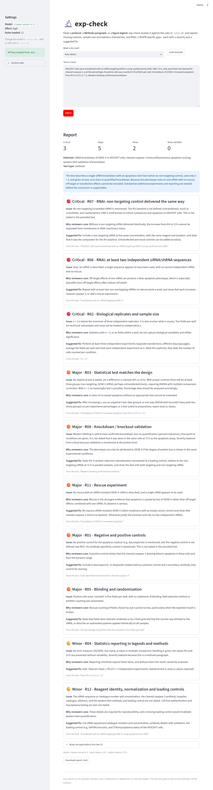

# exp-check

**A reviewer-style checker for wet-lab experimental design.**

Paste a protocol, a Methods paragraph, or a figure legend into a web page and exp-check reviews
it against a plain-English checklist (`rules.md`), the way a careful peer reviewer would. It
reports which controls are missing and why a reviewer would reject the work because of them,
whether the sample size and statistical test match the design, and the checks specific to
RNAi and CRISPR experiments: a single siRNA, no non-targeting control, no knockdown or knockout
validation, a single guide, no off-target assessment, no rescue experiment. Every finding has
a severity (critical / major / minor) and a concrete suggested fix. The rules live in one
Markdown file that anyone can edit without touching code.



## Installation

exp-check runs on your own computer and uses your own Anthropic API key.

**1. Get Python and the code.**
Install Python 3.11 or newer from [python.org](https://www.python.org/downloads/) (on Windows,
tick *Add python.exe to PATH* in the installer). Then download this repository (green
**Code** button → **Download ZIP**, then unzip) or clone it:

```bash
git clone https://github.com/bingksun/exp-check.git
cd exp-check
```

**2. Install the dependencies.**

```bash
pip install -r requirements.txt
```

**3. Add your API key and start the app.**
Copy `.env.example` to a new file named `.env`, open it in any text editor, and paste your
key after `ANTHROPIC_API_KEY=` (get a key at <https://console.anthropic.com/>). Then run:

```bash
python -m streamlit run app.py
```

On Windows you can instead double-click `run_windows.bat`. Your browser opens at
<http://localhost:8501>.

## Using it

1. Choose what kind of text you are pasting (or leave *Auto-detect*).
2. Paste the text and click **Check**. A review takes roughly 20-60 seconds.
3. Read the findings, sorted by severity. Each one says what is missing, why a reviewer
   would care, and what to add or change. Rules that are satisfied, and rules that do not
   apply to your text, are listed below the findings.
4. **Download report (.md)** saves the whole review as a text file.

Click **Load example** to see a run on a deliberately flawed Methods paragraph.

## Customising the rules

All checks are defined in [`rules.md`](rules.md). Each rule is a `## ` heading with an ID and
a name, followed by a plain-English description of what to check, why it matters, and the
default severity. To add a rule, copy an existing one and edit the text; to remove one,
delete it. The file is reloaded on every check, so you only need to refresh the page.

The initial set covers: negative/positive controls, biological replicates and n, choice of
statistical test, statistics reporting in legends, blinding and randomisation, RNAi (two
independent sequences, non-targeting control, knockdown validation), CRISPR (multiple guides
or clones, Cas9/non-targeting control, off-target assessment), rescue experiments, and
reagent identity / loading controls.

## Changing the model

Open [`config.toml`](config.toml) and edit the `model` line. The default is the current
Claude Sonnet (`claude-sonnet-5-5`). The same file sets the thinking effort (`low`, `medium`,
`high`) and the maximum report length.

## Privacy and cost

The text you paste, together with the rules, is sent to the Anthropic API for analysis and
nothing else. Each check costs a few cents on a Sonnet model; the rules are cached between
checks to keep this low. Your API key stays in the local `.env` file, which is excluded from
git by `.gitignore`.

## Limitations

exp-check is an AI-assisted checklist. It can miss problems and it can be wrong, and it does
not replace a statistician, a core facility, or a domain expert. Treat its output as a list
of questions to answer before submission, not as a verdict.

## Evaluation

How well do different Claude models apply the rules? `tests/` holds 75 test cases
(25 handwritten, 50 synthetic, 15 of them clean) with answer keys by rule ID, and scripts
that run every case three times per model through the Batch API.

<!-- eval-table-start -->

_Not run yet. See [docs/eval.md](docs/eval.md) and [tests/README.md](tests/README.md)._

<!-- eval-table-end -->

## License

MIT. See [LICENSE](LICENSE).
